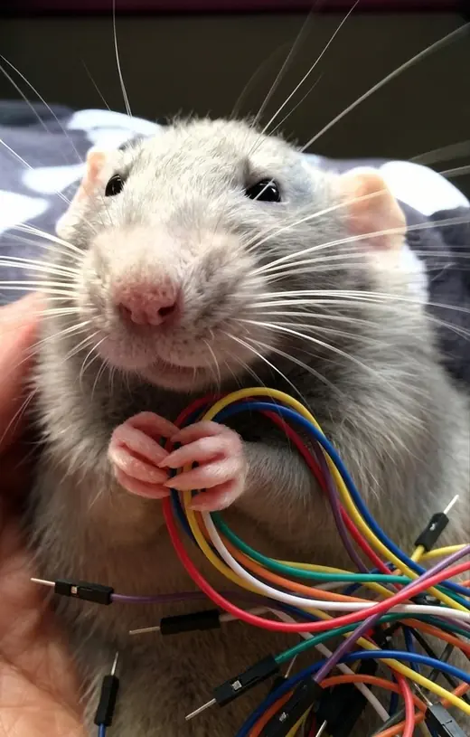

<p align="center">
  
</p>

<p align="center"><em>
Having rewired just about every cable in his home, Ernest still has some juice to spare. While his
neighbours rebuild their once-working power grid, Ernest definitely needs a side project... Help him
focus on new challenges, and give him great, slick schematics for his next circuitry adventure.
</em></p>

# ratsnest

_Graphical wiring for breadboards._ From a circuit described in one declarative file, ratsnest makes
one self-contained page showing how to build it on a breadboard with a Raspberry Pi Pico 2 W, step
by step: the drawing, the steps that pick out their parts, the parts list and a MicroPython script to
test it with. A page is drawn at any quarter turn, in a dark or a light theme, and in English, French
or Russian. Its command is `rnest`, a shorter name for `ratsnest`: the two are synonymous, and the
examples here use `rnest`.

> ⚠️ **ratsnest is still very much a work in progress.** It can occasionally and unexpectedly break.
> Run `rnest update` in your circuits project to move it to the latest ratsnest version. The
> command upgrades every circuit to the latest format and checks them.

The latest release, and every executable it ships, is on the
[Releases](https://github.com/bulla/ratsnest/releases) page.

## Get started

1. **Install ratsnest.** On Linux and macOS:

   ```sh
   curl -fsSL https://raw.githubusercontent.com/bulla/ratsnest/develop/install.sh | sh
   ```

   It installs `ratsnest`, and `rnest` beside it, a link to the same executable. On Windows,
   download `ratsnest-windows-x64.exe` from the [Releases](https://github.com/bulla/ratsnest/releases)
   page and save it as `rnest.exe`. To use a build of your own instead, build it from a clone with
   `bun run build`, and install that one with `RATSNEST_FROM=dist/ratsnest-linux-x64 sh install.sh`.

2. **Make a circuits project**, a folder of your own for your circuits:

   ```sh
   mkdir my-circuits && cd my-circuits
   rnest init
   ```

3. **Add a circuit, with Claude Code.** The project holds ratsnest's `circuit` skill, so in Claude
   Code, `/circuit` adds a circuit, checks it, makes its page, or its drawing alone as an SVG, and
   publishes a page as an Artifact on request. By hand, a circuit is one file in `circuits/`, such as those in
   [`examples/`](examples/), and:

   ```sh
   rnest check
   rnest generate circuits/my-circuit.ts --language en --theme dark --orientation 0
   ```

   The page is written into `pages/`, named by its four inputs. `--format svg` writes the drawing
   alone instead, as an SVG file to put in other pages with ``: it carries its font and its
   credit, and needs nothing else.

4. **Move to a newer ratsnest** when one is released, from anywhere in the project:

   ```sh
   rnest update
   ```

   It puts the latest release in place of the ratsnest you have, moves every circuit to its format,
   and checks them, saying which, if any, need you to decide something.

## Working on ratsnest

[`CONTRIBUTING.md`](CONTRIBUTING.md) walks through setting it up, and `/setup` does it with you.
Why it is built the way it is, one decision at a time, is in [`doc/adr/`](doc/adr/).

## Licence

ratsnest's code is MIT, held by bulla. The drawing of the Pico and the breadboard, in
`src/drawing/`, is CC BY-SA 4.0, as an adaptation of Raspberry Pi's datasheet figure, and every page
is set in Nunito, under the SIL Open Font License 1.1. The picture of Ernest is originally a photo of
Baby, a pet rat, holding a bunch of pasta instead of jumper wires (photo: Maaique). It is not under
the MIT licence. [`ATTRIBUTION.md`](ATTRIBUTION.md)
says what each is and what changed.
